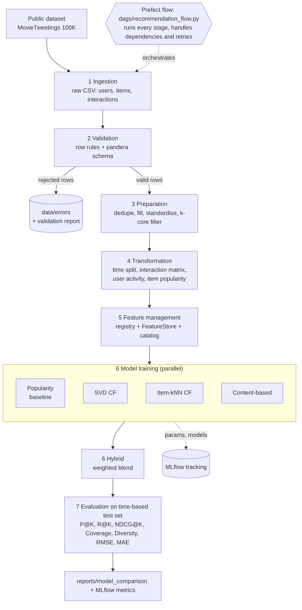

# Recommendation Pipeline: end-to-end data management for a movie recommender

Roll No: 2025AG05172 | DM4ML Lab Assignment 2

Pipeline: **ingestion -> validation -> preparation -> transformation -> feature management -> model training -> evaluation -> orchestration**, on the public MovieTweetings 100K ratings snapshot (users, movies with genres, ratings with timestamps).



(The same diagram as text is in `docs/architecture.mmd`.)

## What is in the repo

| Requirement | Where |
|---|---|
| Ingestion | `src/ingestion/ingest.py` (downloads the dataset, writes raw CSVs, optional logged defect injection) |
| Validation | `src/validation/validate.py`, rejected rows in `data/errors/`, report in `reports/validation_report.md` |
| Preparation and transformation | `src/preparation/prepare.py`, `src/transformation/transform.py` (time-based split, user activity, item popularity, interaction matrix) |
| Feature management | `src/features/` (registry, builder, `FeatureStore`), catalog in `docs/feature_catalog.md` |
| Training (5 models, MLflow) | `src/training/` |
| Evaluation | `src/evaluation/`, results in `reports/model_comparison.md` |
| Orchestration | `dags/recommendation_flow.py` (Prefect), plain runner `src/pipeline.py` |
| Tests | `tests/` (17 tests) |
| Final report | `reports/final_report_2025AG05172.pdf` |

## Setup (Mac)

Python 3.10 or newer is needed (`python3 --version`). If yours is older: `brew install python@3.12` and use `python3.12` below.

```bash
cd recommendation-pipeline
python3 -m venv .venv
source .venv/bin/activate
pip install -r requirements.txt
```

## Run

```bash
python -m src.pipeline            # all stages, plain Python
python dags/recommendation_flow.py   # same stages through Prefect (parallel training, retries)
python -m pytest -q               # tests
```

A full run takes about 30 seconds. A fixed seed makes repeated runs on the same machine identical. Across machines the last decimals can move slightly (for example the content-based model, which has many tied scores); the table below is from a MacBook run.

### Prefect UI and MLflow UI (for screenshots)

Terminal 1:
```bash
source .venv/bin/activate
prefect server start
```
Terminal 2:
```bash
source .venv/bin/activate
export PREFECT_API_URL=http://127.0.0.1:4200/api
python dags/recommendation_flow.py
```
Open http://127.0.0.1:4200/runs to see the run and its task graph.

MLflow (Terminal 3):
```bash
source .venv/bin/activate
mlflow ui --backend-store-uri sqlite:///mlflow.db --port 5000
```
Open http://127.0.0.1:5000.

Scheduled mode (daily at 02:00): `python dags/recommendation_flow.py --serve`.

## Orchestration and dependencies

```
ingest -> validate -> prepare -> transform -> features -> [popularity | svd_cf | item_knn_cf | content_based] -> hybrid -> evaluate -> summary
```
Each stage reads and writes files (parquet/CSV), so any stage can be re-run alone with `python -m src.pipeline --stage <name>`. The hybrid model waits for the four models it combines.

## Data notes

- Dataset: MovieTweetings 100K snapshot (`sidooms/MovieTweetings`), ratings 0-10, rating >= 8 counts as "liked". User details in this dataset are limited to an id, so user features are derived from behaviour.
- Defect injection: the raw data is almost clean, so ingestion adds a small, logged set of defects (`data/raw/injected_faults.csv`, 0.2% of rows per defect type) to show that validation works. Switch off with `ingestion.inject_faults: false` in `configs/config.yaml`.
- Other datasets: set `dataset.name` to `movielens100k` (has age, gender, occupation) or `synthetic`. The MovieLens adapter is covered by a test on the original file layout; the reported results come from MovieTweetings.

## Results (K = 10, time-based test set, 1,892 test users)

| model | Precision@10 | Recall@10 | NDCG@10 | Coverage | Diversity | RMSE | MAE |
|---|---:|---:|---:|---:|---:|---:|---:|
| popularity (baseline) | 0.0253 | 0.1236 | 0.0635 | 0.0131 | 0.6672 | 1.5897 | 1.1970 |
| svd_cf | 0.0233 | 0.1097 | 0.0650 | 0.0367 | 0.6995 | 1.4588 | 1.0834 |
| item_knn_cf | 0.0261 | 0.1219 | 0.0701 | 0.2554 | 0.6841 | n/a | n/a |
| content_based | 0.0036 | 0.0177 | 0.0108 | 0.5866 | 0.1282 | n/a | n/a |
| hybrid | 0.0264 | 0.1263 | 0.0724 | 0.0986 | 0.6733 | n/a | n/a |

Full tables for K = 5 and K = 10 are in `reports/model_comparison.md`.

## Limitations

Data is sparse (0.55% matrix density) and covers six months, so absolute scores are low and the gap between models is small. Test users and items that never appear in train are dropped (cold start is not handled). Features are computed once per run, not served online.
